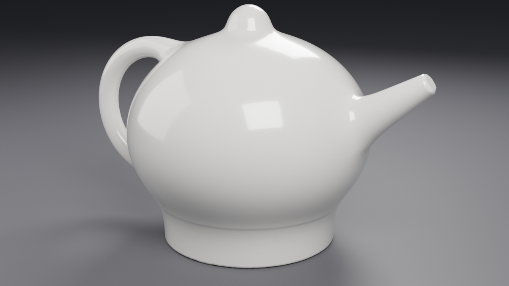
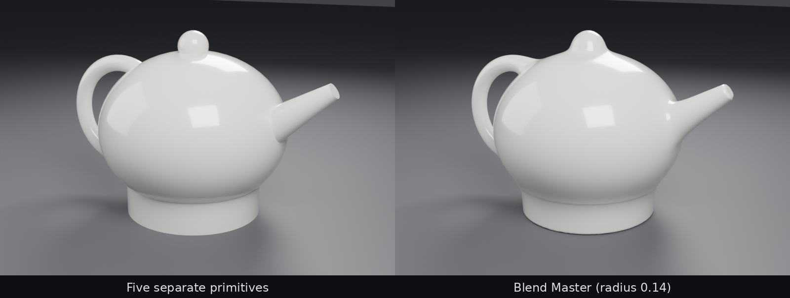
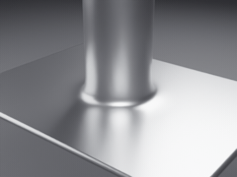
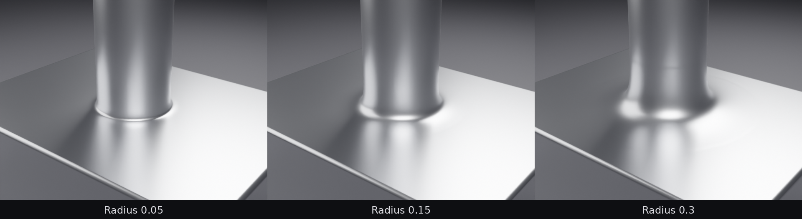
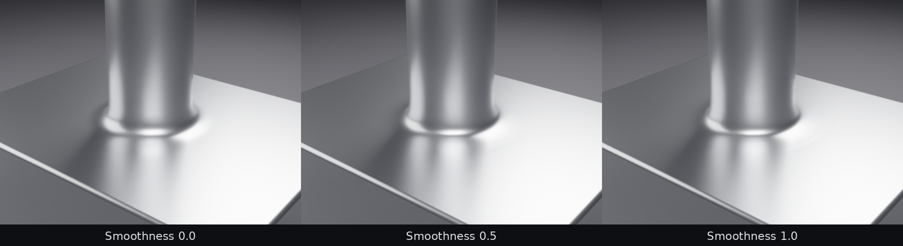
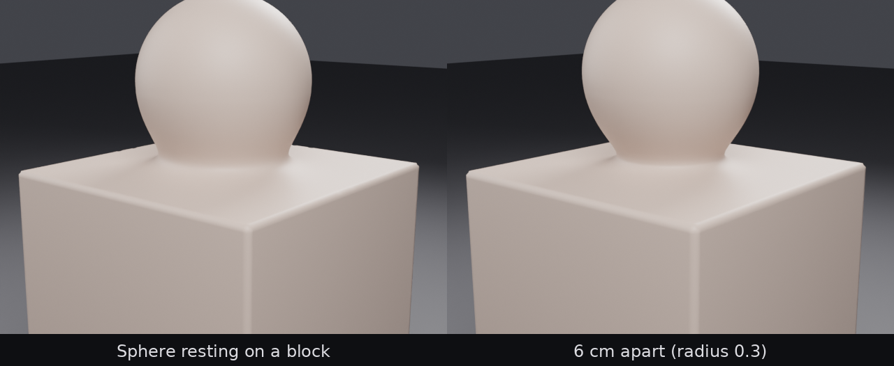

# Blend Master

**Fuse meshes with smooth, live, non-destructive blends.** A Blender add-on
for Blender 4.2 LTS and newer.



Select two or more meshes, click **Blend**, adjust the radius. Blend Master
fuses them into one watertight surface with a smooth fillet wherever they
meet. Your original objects are never touched: move, rotate, scale or edit
any of them and the blend follows live. When you're done, **Apply** it to a
regular mesh, or **Remove** it and get your scene back exactly as it was.



## Features

- **One click, any number of parts.** Handles, spouts, knobs, pipes into
  walls, horns on heads, kitbash parts.
- **Live and non-destructive.** The result is a Geometry Nodes modifier that
  reads your objects, *including their own modifiers* (Bevel, Subdivision,
  Mirror ...). Nothing you made is changed.
- **Clean surfaces.** The result is projected onto your exact geometry. Flat
  faces stay flat, curved ones stay true, with no voxel stepping. The fillet
  is a C²-smooth blend with no seams or pinching.
- **Always watertight.** Manifold, single-shell output, ready for 3D printing.
- **Parts that only touch, or nearly touch, fuse with a neck** instead of
  leaving a crack.
- **Buried geometry doesn't bulge the surface.** Parts sunk below a face
  leave it flat.
- **Follows your shading.** Smooth-shaded areas are treated as the curved
  surface they represent. Flat faces and sharp edges (including *Smooth by
  Angle*) stay crisp.
- **Materials carried over** from the nearest source face.
- **Fast preview, final quality for render:** separate viewport and render
  resolutions, like the Subdivision modifier.
- **Apply / Remove / Repair**, all undoable, and Blend never duplicates
  anything however often you click it.



## Requirements

Blender **4.2 LTS or newer**, including 5.x. Tested on 4.2.23 LTS,
4.5.16 LTS and 5.2.3 LTS. No other dependencies.

## Installation

1. Download `blend_master-1.0.0.zip` from the
   [Releases](https://github.com/R-enord/blend-master/releases) page, or build
   it yourself (see [Development](#development)).
2. In Blender, drag the zip into the window. Alternatively, open
   *Edit → Preferences → Get Extensions*, then the **⌄** menu (top right) →
   *Install from Disk…*, and pick the zip.
3. Open the 3D Viewport sidebar (`N`) and find the **Blend Master** tab.

## Quick start

1. Select the meshes to fuse. Click the main body **last**, so it is the
   active object: the result is placed at its origin.
2. *Sidebar → Blend Master → **Blend*** (also in *Object* menu and the
   right-click menu).
3. The parts turn into wireframes and the blended result appears. Adjust
   **Radius** and **Smoothness**.
4. Keep modelling: click a wireframe to select a source, then move or edit it.
5. Finish with **Apply** (bake to a mesh) or **Remove** (undo the whole blend).

To add more parts later, select the result and the new parts and click
**Blend** (or **Add Selected**). **Remove Selected** takes parts out again.

## Settings

| Setting | What it does |
|---|---|
| **Radius** | Size of the blend. Where two faces meet at 90° the fillet is as deep as a round fillet of this radius. Parts closer than about half the radius fuse with a neck. |
| **Smoothness** | Profile of the blend. `0` is tight and round. `1` runs out softly and gradually into the surfaces. |
| **Shade Smooth** | Smooth shading on the result. |
| **Viewport / Render Resolution** | Voxels along the longest side of the whole blend. The viewport value is for interactive editing; the render value is used for F12 and for Apply. Higher means more detail and slower updates. |
| **Show Sources As** | Draw the source objects as *Wire*, *Bounds*, or hide them. Sources never render. |

All settings live on the `BM_Blend` modifier of the result. They can be
keyframed, driven, and also edited from the Properties editor.

| Radius | Smoothness |
|---|---|
|  |  |



### Apply

Bakes the blend into a regular mesh on the result object and hands control
back to you. Options:

- **Render Quality** (default on): bake at the render resolution with full refinement.
- **Sources:** *Hide* (default; the originals are kept, hidden, so you can
  always go back), *Keep* (leave them visible) or *Delete*.

Your own modifiers on the result object (for example a Decimate you added
after Blend Master's) are kept and keep working on the baked mesh.

### Remove

Deletes the result and restores every source exactly: display, render
visibility, collections, no leftover properties, node groups or data.

### Repair

Appears only when needed. Example: you deleted a result object by hand. The
add-on then restores its sources and rebuilds its node groups.

## Tips

- **Speed.** The viewport resolution is the main dial. The default (96)
  updates in about 0.1–0.7 s on a 4-core machine, depending on how much of
  the surface is blended. Lower it while posing parts, and raise the render
  resolution for the final quality.
- **Low-poly curves.** Smooth-shaded curves are handled automatically. If a
  part is *flat*-shaded on purpose, its facets are kept.
- **Small details** below about one voxel are softened. Raise the
  resolution, or blend fewer, smaller parts at a time. The resolution is
  relative to the whole blend.
- **The result object's own transform doesn't matter.** The blend always
  sits where the sources are. Move the sources, not the result.
- **Animation:** everything is live, so animated sources (or keyframed
  Radius) update every frame. Apply before export.

## How it works

Every source contributes a signed distance field. The blended surface is the
zero level of a *smooth minimum* of those fields: identical to a plain union
where only one part is near, and adding a fillet where two parts are within
Radius of each other. The Geometry Nodes group (generated in Python, see
`blend_master/nodes.py`):

1. **Gathers** the sources from a collection, with their modifiers, and
   gives smooth-shaded low-poly parts a Catmull–Clark pass creased at sharp
   edges.
2. **Voxelizes** them into a watertight union, growing spheres into the
   regions the blend fills so that touching parts get a proper neck.
3. **Projects** every vertex onto the true surface. Away from the junction
   it raycasts onto your exact geometry. In the blend zone it takes Newton
   steps on the smooth minimum, with relaxation and automatic repair of any
   folded faces.

The design decisions (Blender versions, result object, licensing, ...) are
in [docs/DECISIONS.md](docs/DECISIONS.md).

## Known limitations

- **UV maps are not carried over** (the result is a new surface). Materials
  are. UV transfer is planned.
- **Hard-surface topology isn't preserved:** the result is a dense,
  even mesh. Sharp convex edges are softened to about one voxel. A
  topology-preserving hard-surface mode is on the roadmap.
- Where a fillet runs over a **sharp edge of another part**, that edge can
  show a slight ripple in extreme close-ups. Lower the Radius or raise the
  resolution.
- **Non-mesh objects** (curves, text, metaballs) are not accepted as
  sources. Convert them to meshes first.
- Very large blends at high resolution are heavy. Keep the viewport
  resolution modest and bake with Apply.

## Roadmap

- Per-object radius, and blend masks (vertex group / painted)
- Presets: *Tight hard-surface*, *Organic soft*, *Print-ready*
- UV transfer from the sources
- Topology-preserving *Hard-surface* mode
- Manifold check / report for 3D-print export

## Development

```
blend_master/        the extension (this folder is what ships)
  blender_manifest.toml
  __init__.py        registration and file-load handler
  nodes.py           builds the Geometry Nodes groups in code
  operators.py       Blend, Apply, Remove, Add/Remove Selected, Repair...
  properties.py      bookkeeping property group, preferences
  ui.py              the N-panel
  utils.py           tagging, lookups, helpers
tests/               headless acceptance tests + test scenes
tools/build.py       builds dist/blend_master-<version>.zip
tools/render_docs.py renders the images in this README
docs/                design decisions, testing guide, images
```

```bash
python tools/build.py                                     # build the zip
blender -b --factory-startup --python tests/run_tests.py  # run the tests
blender --python tests/build_test_scenes.py               # scenes for manual testing
```

The tests also run with Blender's `bpy` module from PyPI
(`pip install bpy==4.2.23`, then `python tests/run_tests.py`). That is what
CI does on every push for Blender 4.2, 4.5 and 5.2. See
[docs/TESTING.md](docs/TESTING.md) for the full checklist, including the
manual pass before a release.

## License

GPL-3.0-or-later (see [LICENSE](LICENSE)), like Blender itself. You may use
Blend Master in any project, commercial or not. Everything you make with it
is yours.

Copyright © 2026 Abdulsalam Jamiu Adeniyi.
